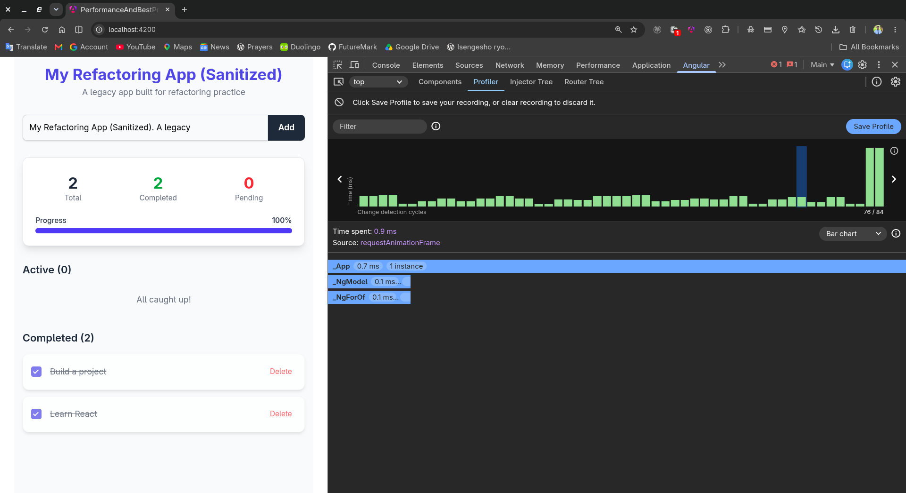
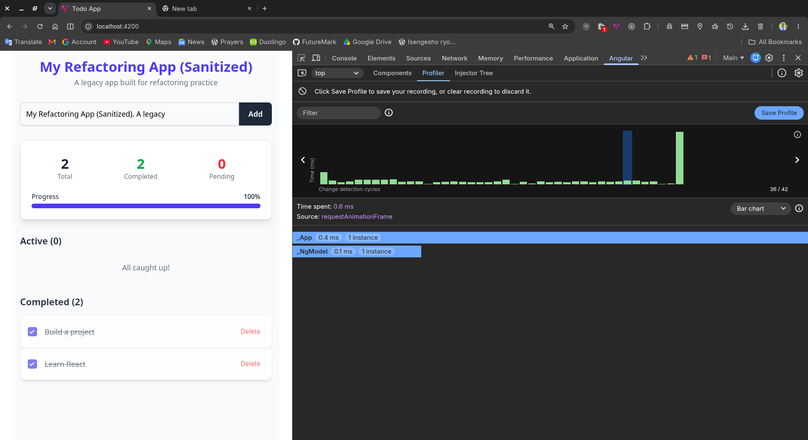

# To-Do App — Refactored for Performance (FEM19)

The lab's legacy single-component To-Do app, refactored with `OnPush` change detection, signals/`computed()`,
`track`ed lists, the `async` pipe, a cached "API" call, DOM sanitising and small reusable components/services.
The original code is kept for comparison in `docs/legacy-todo-app.ts`. Full write-up:
`../notes/FEM19-Performance-Refactor.md`.

## Run

```bash
npm install
npm start          # http://localhost:4200
npm test           # Jest (60 tests)
npm run build      # production build
```

## Commit history

One commit per refactoring step, oldest first (each of steps 1-6 builds on its own):

| # | Commit | Step | What changed |
|---|---|---|---|
| 1 | `afcb11b` | Baseline | New project (Tailwind, Jest), the legacy component dropped in unchanged, `perf/measure.mjs` and the baseline results |
| 2 | `b9a9af9` | Change detection | `OnPush` on the root; both `*ngFor` loops become `@for ... track todo.id` |
| 3 | `ac19867` | State | `TodoService` with signals and `computed()` replaces `getStats()`/`getProgressPercentage()` and the `*ngIf` filters |
| 4 | `bac8828` | RxJS | `async` pipe replaces manual subscribe/unsubscribe; `shareReplay` makes the welcome call run once |
| 5 | `f6e0dcf` | Security | Pure `sanitizeHtml` pipe (`DomSanitizer`) replaces `bypassSecurityTrustHtml` and raw `[innerHTML]` |
| 6 | `3523aba` | Modularity | Monolith split into a thin shell plus 5 presentational `OnPush` components |
| 7 | `6c6da96` | Tests | 60 Jest tests for the service, pipe and components |
| 8 | `112a7ce` | Docs | After-refactor measurements, profiler screenshots, notes |
| 9 | this commit | Docs | This commit-history section |

`git log --oneline -- "FEM19-Performance-and-Best Practices"` shows the same list.

## Structure

```
src/app/
  app.ts, app.html                  page shell (OnPush), wires service signals into components
  core/
    models/todo.model.ts
    services/todo.service.ts        todos signal + computed stats; add/toggle/delete (immutable updates)
    services/welcome.service.ts     simulated API call, cached with shareReplay
    pipes/sanitize-html.pipe.ts     DomSanitizer-based, pure pipe for [innerHTML]
  components/                       presentational ("dumb"), all OnPush, signal inputs/outputs
    welcome-header/  add-todo-form/  todo-stats/  todo-section/  todo-item/
perf/
  measure.mjs                       counts change-detection work for scripted interactions
  results-before.json / results-after.json
  check-ui.mjs                      screenshot + XSS smoke check
```

## Before / after (dev build, 52 todos in the list)

Measured with `perf/measure.mjs`: it counts how many times Angular ran component *templates* (one run = one
component/embedded view re-checked) during a scripted interaction. Lower is better.

| Interaction | Template runs before | after | `getStats()` calls before | after |
|---|---:|---:|---:|---:|
| Mouse moved 200 times | 0 | 0 | 0 | – |
| Typed 30 characters in the input | 4,396 | 24 | 252 | – |
| Ticked one task as done | 629 | 60 | 36 | – |
| Added one task | 957 | 65 | 54 | – |

| Script time (Chrome `ScriptDuration`) | before | after |
|---|---:|---:|
| Typing 30 characters | 37.3 ms | 5.1 ms |
| Ticking one task | 7.8 ms | 2.6 ms |
| Adding one task | 5.2 ms | 1.3 ms |

Production bundle (initial): 223.35 kB raw / 64.00 kB gzip before -> 227.25 kB / 65.67 kB after. The refactor did
**not** shrink the bundle (more components); the gains are all at runtime. Mouse movement costs nothing in both
versions because the page registers no `mousemove` listener, and Angular only checks after events it listens to.

## Angular DevTools profiler (before / after)

Same interaction in both: typing the text "My Refactoring App (Sanitized). A legacy" (39 characters) into the input
with the 2 seed todos, then selecting one change-detection cycle in the profiler.

| | Before (`perf/profiler-before.png`) | After (`perf/profiler-after.png`) |
|---|---|---|
| Change-detection cycles recorded | 84 | 42 |
| Selected cycle | 0.9 ms | 0.6 ms |
| Components checked in that cycle | `_App` (0.7 ms), `_NgModel`, **`_NgForOf`** | `_App` (0.4 ms), `_NgModel` |




The key difference is `_NgForOf`: before, the two todo lists were re-checked on every keystroke; after, they are not
touched. The cycle count is just what the profiler recorded for the same typing; I did not verify why it halves.
With only 2 todos the per-cycle time difference is small; the 52-todo script above shows the effect at a realistic list size.

Not measured here: Lighthouse scores.
